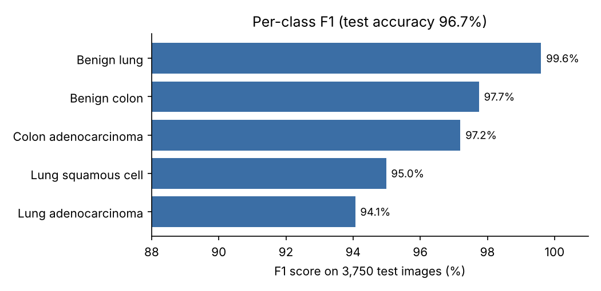
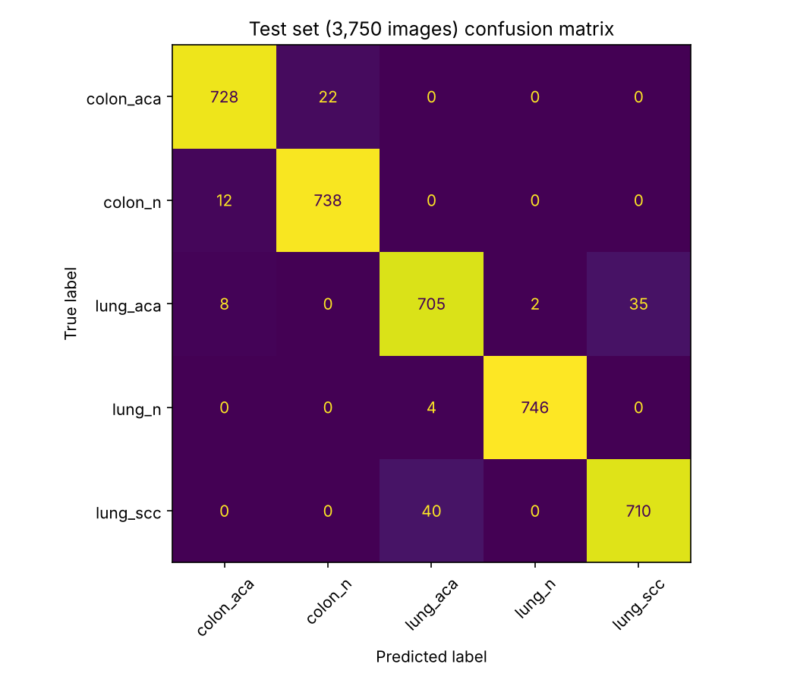
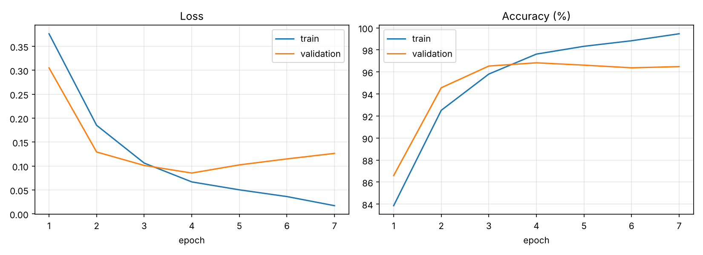
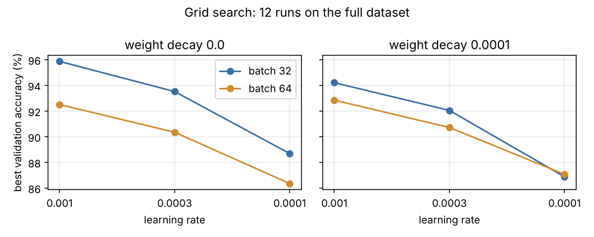

# Lung & Colon Cancer Classifier


A convolutional neural network in **PyTorch** that classifies microscope images of lung and colon tissue into **five types**, three of them cancerous. It improves a 61.5% baseline to **96.7% test accuracy (96.7% macro F1)** on 3,750 held-out images.

| Class | Meaning |
|---|---|
| `lung_n` | Benign lung tissue |
| `lung_aca` | Lung adenocarcinoma |
| `lung_scc` | Lung squamous cell carcinoma |
| `colon_n` | Benign colon tissue |
| `colon_aca` | Colon adenocarcinoma |

## Why

Diagnosing cancer from histopathology slides is the gold standard, but it is slow and needs specialist pathologists. A reliable classifier can act as a second opinion: it can flag likely cancer and help separate subtypes, while the final decision stays with a doctor.

## Results

| Model | Data | Test accuracy | Macro F1 |
|---|---|---|---|
| Baseline: 2 conv layers, SGD, 3 epochs | 1,000 images | 61.5% | – |
| Tuned CNN, notebook version (random split, fixed 5 epochs) | 25,000 images | 96.43% | 96.36% |
| **Tuned CNN, this package (stratified split, early stopping)** | **25,000 images** | **96.72%** | **96.72%** |

The final row comes from running `python -m cancer_classifier.train --epochs 10` on a free Colab T4 GPU (about 15 minutes). The best model came from epoch 4. After that, validation loss started rising while training loss kept falling, which is the start of overfitting. Early stopping caught it and kept the epoch-4 weights.





The confusion matrix shows **the model almost never mixes up the two organs**. No colon image was predicted as lung, and only 8 of 2,250 lung images were predicted as colon. Nearly all its mistakes are *within* an organ:
- **Lung adenocarcinoma ↔ lung squamous cell carcinoma** (75 of 3,750 images). These two cancers look similar under the microscope and are the hardest classes (94.1% and 95.0% F1).
- **Colon adenocarcinoma ↔ benign colon** (34 images).

Benign lung tissue is close to perfect (99.6% F1).



Full numbers: [`results/my_run/metrics.json`](results/my_run/metrics.json) (this run) and [`results/test_metrics_full_dataset.json`](results/test_metrics_full_dataset.json) (notebook version).

## How the model got from 61.5% to 96.7%

1. **More feature extraction.** Going from 2 to 3 conv layers (16 → 32 → 64 channels) lets the network learn patterns at several scales: texture, then clusters of cells, then tissue structure.
2. **A stronger classifier head.** A hidden layer (16,384 → 128 → 5) combines the features before the final decision, which helps separate visually similar classes.
3. **Input normalisation.** Scaling pixels to roughly [-1, 1] makes training more stable and faster to converge.
4. **Adam and the full dataset.** Moving from SGD to Adam, and from 1,000 to 25,000 images, with a **70/15/15 train/validation/test split**. All tuning uses the validation set, and the test set is used once at the end.
5. **Hyperparameter search.** 12 runs over learning rate, batch size and weight decay (results below).

### Grid search



- **Learning rate mattered most.** 0.001 beat 0.0003 and 0.0001 in every setting.
- **Batch size 32 beat 64.** The noisier gradients of smaller batches helped the model generalise.
- **Weight decay didn't help** in the best setting.
- **Best:** lr = 0.001, batch size = 32, weight decay = 0, giving **95.87% validation accuracy**. Full table: [`results/grid_search_full_dataset.csv`](results/grid_search_full_dataset.csv).

### The dropout experiment

Dropout is usually added to prevent overfitting, so I tested it (spatial dropout after each conv block, plus dropout before the output layer). **Validation accuracy dropped from 95.9% to about 91.5%.** The model was already generalising well, and dropout took away capacity it needed, so it was **underfitting**. Dropout is therefore **off by default**. It can be switched back on with `--dropout 0.5` to reproduce the experiment.

## Project structure

```
src/cancer_classifier/
    data.py         dataset loading, stratified train/val/test split, transforms
    model.py        the CNN (dropout optional)
    engine.py       training loop with best-checkpointing and early stopping, metrics
    train.py        CLI: train, evaluate on the test set, save model/metrics/plots
    grid_search.py  CLI: hyperparameter search, results saved to CSV
    predict.py      CLI: classify your own images with a trained model
    plots.py        training curves and confusion matrix
tests/              pytest suite on a small synthetic dataset (no download needed)
notebooks/          the original experiments, in order (baseline -> improved -> grid search -> dropout)
results/            results and charts from the full-dataset runs
```

## Getting started

### 1. Install

```bash
git clone https://github.com/Yassman04/lung-colon-cancer-classifier.git
cd lung-colon-cancer-classifier
python -m venv .venv && source .venv/bin/activate   # Windows: .venv\Scripts\activate
pip install -e ".[dev]"
```

### 2. Get the data

Download the **LC25000** dataset (about 1.8 GB) from [Kaggle](https://www.kaggle.com/datasets/andrewmvd/lung-and-colon-cancer-histopathological-images) and unzip it into `data/`. The code finds the five class folders anywhere inside it, so the original Kaggle layout works as it is:

```
data/lung_colon_image_set/
    lung_image_sets/   lung_aca/  lung_n/  lung_scc/
    colon_image_sets/  colon_aca/ colon_n/
```

### 3. Train and evaluate

```bash
# quick check on 200 images per class (a few minutes on a laptop CPU)
python -m cancer_classifier.train --data data --max-per-class 200 --epochs 3

# full run with the best settings (a GPU is recommended)
python -m cancer_classifier.train --data data --epochs 10 --out results/run
```

This saves `best_model.pt`, `metrics.json`, `training_curves.png` and `confusion_matrix.png` to the output folder. Training keeps the checkpoint with the lowest validation loss and stops early if validation stops improving.

### 4. Hyperparameter search

```bash
python -m cancer_classifier.grid_search --data data --epochs 3
```

### 5. Classify your own images

```bash
python -m cancer_classifier.predict --model results/run/best_model.pt path/to/image.jpeg
# image.jpeg: Lung adenocarcinoma (97.8% confidence)
```

### 6. Run the tests

```bash
pytest -q
```

The tests build a tiny fake dataset on the fly, so they run in seconds without the real data. They check:
- the model's output shapes
- that the train/val/test splits never overlap and include every class
- that runs can be reproduced with a seed
- a full train → evaluate → predict run
- the grid search

They also run automatically on every push through GitHub Actions.

## Limitations and next steps

- **Possible data leakage.** LC25000 was created by augmenting about 1,250 original images up to 25,000. Near-copies of the same original can land in both the training and test sets, which may make the test score look better than it would be on genuinely new slides. The next step is to evaluate on an external dataset from a different hospital.
- **Transfer learning.** Compare against a pretrained ResNet or EfficientNet fine-tuned on the same split.
- **Explainability.** Add Grad-CAM heatmaps to show which parts of the tissue drive each prediction, which matters for clinical trust.
- **Not a medical device.** This is a research and learning project and must not be used for diagnosis.

## Tech

Python · PyTorch · torchvision · scikit-learn · matplotlib · pytest · GitHub Actions

Dataset: Borkowski A. A. et al. (2019), *Lung and Colon Cancer Histopathological Image Dataset (LC25000)*, [arXiv:1912.12142](https://arxiv.org/abs/1912.12142).
